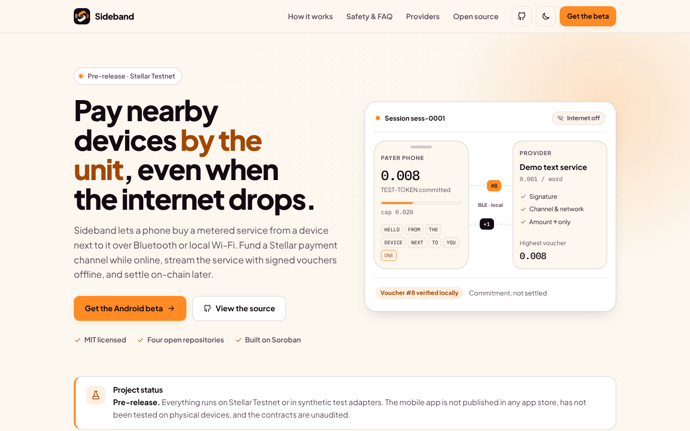
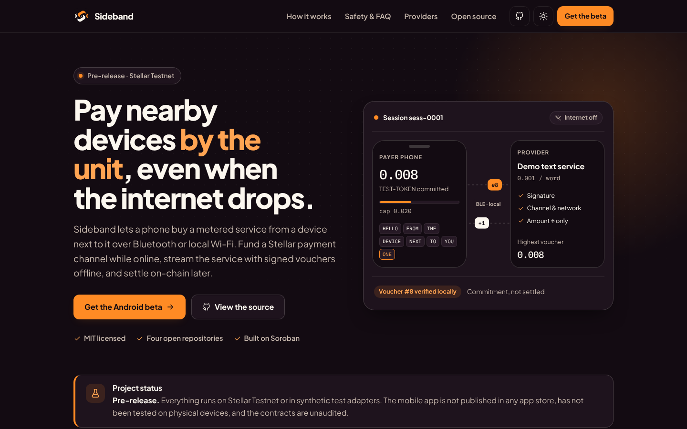
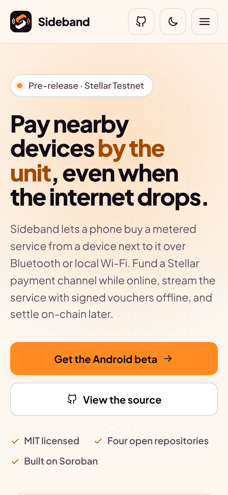
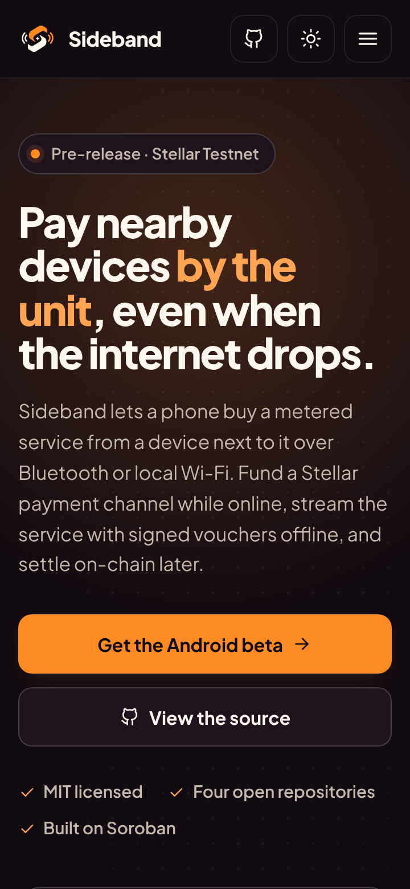
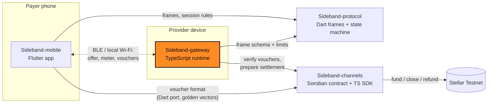

<div align="center">


# Sideband Gateway

**The provider runtime for Sideband, and the product website.**

Part of [Sideband](#how-sideband-works): nearby services, metered value, Stellar settlement.

[](https://github.com/Sideband34/Sideband-gateway/actions/workflows/ci.yml)
[](./LICENSE)
[](#status)
[](./SECURITY.md)

[How it works](#how-sideband-works) · [Quickstart](#quickstart) · [Status](#status) · [Architecture](#architecture) · [Contributing](#contributing) · [Security](#security)

</div>

> [!WARNING]
> Pre-release software for **Stellar Testnet and synthetic assets only**. The channel contract and
> voucher format are **unaudited**. Do not use with real funds.

## What this repository is

The software a **provider** runs to sell a metered service to nearby phones, plus the Sideband
landing site in [`apps/landing`](./apps/landing).

- **Session API** (`src/gateway.ts`, `src/http`): versioned v1 HTTP API
  ([OpenAPI](./docs/openapi.yaml)): session offer/accept with funded-channel binding, network and
  provider checks, one-time nonces, one session per channel and spend caps. Zod-validated input,
  16 KiB body limit, documented error schema and request ids.
- **Voucher acceptance** via `@sideband/channels` (ed25519, domain separation, atomic
  compare-and-swap) with durable SQLite voucher, nonce and session stores that survive restart.
- **Metered demo service**: per-word text processing that refuses unpaid work with HTTP 402, and
  a usage meter that reports payer/provider discrepancies.
- **Settlement preparation**: intents move `CREATED → AUTHORIZED → SUBMITTED`, `RECONCILING`
  after a timeout, `CONFIRMED` only with finality evidence for the right network.
- **Auth and limits**: per-session HMAC bearer tokens, an admin token for settle/status, and
  token-bucket rate limiting with `429` + `Retry-After`.
- **Provider manifest**: provider-signed service manifest and a payer-side verifier.

## Screenshots

The landing site (`apps/landing`), built and captured with Playwright at 1440 px and 390 px:

| Light | Dark |
|---|---|
|  |  |
|  |  |

Full-page captures: [light](./docs/screenshots/landing-desktop-light-full.png) ·
[dark](./docs/screenshots/landing-desktop-dark-full.png) ·
[hero animation, mobile](./docs/screenshots/landing-mobile-light-demo.png).

## Quickstart

Requires Node 22.13+. The channels SDK is a `file:` dependency on a sibling checkout.

```bash
git clone https://github.com/Sideband34/Sideband-channels
git clone https://github.com/Sideband34/Sideband-gateway
(cd Sideband-channels && npm ci && npm run build)
cd Sideband-gateway
npm ci
npm run check                         # prettier, eslint, tsc, 55 vitest tests

# Run a provider with ONE synthetic channel in the in-memory test adapter (loopback only)
DEV_PAYER_PUBLIC_KEY=GBIRYNFBULFVEHPRNOZENOG6RZ4ZPTRDLR7HNMRKHV2QHISIDHOYV6ZN npm start
curl localhost:3001/v1/health         # {"status":"ok","schemaVersion":1,...}
```

`Ctrl-C` prepares settlement for all accepted value and exits cleanly. `npm run fixtures`
regenerates [`fixtures/session-transcript.json`](./fixtures/session-transcript.json), the
synthetic transcript sibling repos test against. Configuration is in
[`.env.example`](./.env.example).

Landing site:

```bash
cd apps/landing
npm ci
npm run lint && npm run typecheck && npm test && npm run build   # static export in out/
```

The site never shows store links unless real listings are configured; see
[`apps/landing/README.md`](./apps/landing/README.md).

## Status

| Area | Status |
|---|---|
| v1 API, auth, rate limiting, durable stores | Implemented, tested |
| Voucher validation and anti-replay | Implemented, tested |
| Metered demo service, usage meter | Implemented, tested |
| Settlement intents and reconciliation | Implemented, tested with a fake Soroban client |
| `ADAPTER=soroban` against Testnet | **Not run**: default runtime is the in-memory test adapter (`synthetic: true`, never `CONFIRMED`) |
| Multi-instance rate limiting, TLS, key rotation, metrics | Not implemented |
| Landing site | Implemented: static export, 27 tests (accessibility, honesty, store-badge gating) |
| Hosted deployment of the site | None yet |

### Compatibility

| Repository | Used for |
|---|---|
| [Sideband-channels](https://github.com/Sideband34/Sideband-channels) v0.1.0 | voucher verification, CAS interface, channel adapters, settlement intents |
| [Sideband-protocol](https://github.com/Sideband34/Sideband-protocol) v0.1.0 | frame field names and limits (`service_offer`, `session_accept`, `voucher`, `meter_sample`) |
| [Sideband-mobile](https://github.com/Sideband34/Sideband-mobile) | payer client; decodes the session transcript fixture and runs an e2e test against this gateway |

## How Sideband works

Sideband lets a phone pay a nearby device for a small metered service (for example, text
processing priced per word) over Bluetooth LE or local Wi-Fi, without needing the internet during
the session:

1. **Fund a channel (online).** The payer deposits a Testnet asset into a Soroban payment channel
   bound to one provider.
2. **Discover nearby.** Devices find each other locally, verify the provider's signed service
   manifest, and agree on price, units and a spending cap.
3. **Stream with signed vouchers (offline).** Each metered unit is paid with a cumulative,
   domain-separated voucher signed on the phone. The provider verifies it locally and rejects
   replays and rollbacks.
4. **Settle later (online).** The provider submits its highest voucher on-chain; the rest of the
   deposit is refundable to the payer after expiry.

A voucher is a commitment against already-locked funds, **not** a completed payment. Nothing is
shown as settled until Stellar confirms it.

## Architecture

Four repositories, one responsibility each. No payment signing lives in transport code, and no
chain logic lives in the app. This repository is highlighted.



| Repository | Stack | Responsibility |
|---|---|---|
| [Sideband-mobile](https://github.com/Sideband34/Sideband-mobile) | Flutter | Payer app: discovery UX, spend limits, voucher signing, history and receipts |
| [Sideband-protocol](https://github.com/Sideband34/Sideband-protocol) | Dart | Versioned session frames, canonical encoding, session state machine, metering, transport contract |
| [**Sideband-gateway**](https://github.com/Sideband34/Sideband-gateway) | TypeScript | Provider runtime: signed manifest, metered service, anti-replay voucher validation, settlement prep, landing site |
| [Sideband-channels](https://github.com/Sideband34/Sideband-channels) | Rust · TypeScript | Soroban payment channel contract, cumulative voucher format, channel adapters, settlement intents |

Cross-repo contracts are pinned with fixtures: voucher golden vectors from `Sideband-channels`,
and a synthetic session transcript from `Sideband-gateway`. See
[`docs/ARCHITECTURE.md`](./docs/ARCHITECTURE.md) for data and ownership paths.

## Contributing

Contributions are welcome. Start with [CONTRIBUTING.md](./CONTRIBUTING.md) for the local checks and
workflow, and pick from the scoped work in
[docs/CONTRIBUTOR_ISSUES.md](./docs/CONTRIBUTOR_ISSUES.md): each item lists its interfaces,
acceptance tests and size. Please follow the [Code of Conduct](./CODE_OF_CONDUCT.md).

**Drips Wave.** Sideband intends to participate in
[Drips Wave](https://docs.drips.network/wave/maintainers/participating-in-a-wave/) on Stellar.
Participation and rewards depend on organizer approval and are not guaranteed. Wave issues are
real, scoped work in this repository's boundary, never filler.

## Security

Please report vulnerabilities privately; see [SECURITY.md](./SECURITY.md). The threat model is
in [docs/SECURITY.md](./docs/SECURITY.md). Never post keys or seeds in issues, even Testnet ones.

## Project documents

[PRD](./docs/PRD.md) · [Requirements](./docs/SRD.md) · [Architecture](./docs/ARCHITECTURE.md) ·
[Stellar protocol](./docs/STELLAR_PROTOCOL.md) · [Roadmap](./docs/ROADMAP.md) ·
[Brand](./docs/BRAND.md) · [Agent rules](./AGENTS.md)

The approved logo is in [`brand/`](./brand) and shared by all four repositories.

## License

[MIT](./LICENSE)
